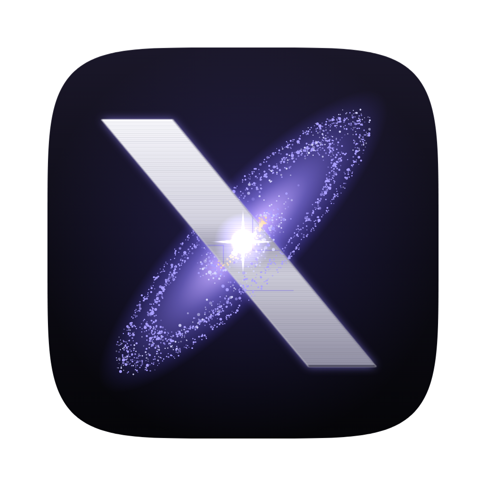

<div align="center">



# GOD OF THE VOID

## El estudio que piensa, habla, dibuja, filma y compone en tu Mac

*Una app y un motor, creados por [**CHAOS-X**](https://chaosx.space/es/). Todo corre en tu equipo, y la nube entra sólo si tú la pides.*

Trae un agente de programación, una voz con la que puedes hablar y motores de imagen,
vídeo, música y sonido. Todo lo escribimos desde cero en Rust, sobre MLX de Apple
(nada de Python, y tampoco hay servidores que alquilar ni telemetría).

| Quieres | Toma esto | Tamaño |
|---|---|---|
| **La app** | `GOD OF THE VOID.app` en [**Releases**](https://github.com/CHAOSX-SPACE/god-of-the-void/releases) | 478 MB |
| **Sólo el motor** (sin ventana) | `god-of-the-void-engine-…-macos-arm64.tar.gz` en [**Releases**](https://github.com/CHAOSX-SPACE/god-of-the-void/releases) · [qué hace](#el-motor-sin-la-app) | 78 MB |
| **Armarla tú** | `cargo run --release -p gotv-empaquetar` (ver [CONSTRUIR.md](CONSTRUIR.md)) | |


[**Manual de uso** (en inglés)](manual/README.md) · [Modelos en Hugging Face](https://huggingface.co/god-of-the-void) · [chaosx.space](https://chaosx.space/es/) · [English](README.md)

</div>

---

## Míralo en dos minutos

https://github.com/user-attachments/assets/98cb8bbe-d991-4763-8779-476d0df5cefa

*El vídeo recorre la ventana zona por zona, con narración. [In English](README.md#see-it-in-two-minutes) · y el [manual de uso](manual/README.md) completo, que está en inglés.*

---

Otros estudios te alquilan un cerebro que vive en el centro de datos de alguien más.
Este vive en tu Mac.

Lee tu código, corre tus pruebas y arregla lo que se rompe. Le hablas y te contesta en
voz alta. Le pides una imagen, un vídeo, una canción o el sonido de la lluvia y lo hace
ahí mismo, con modelos que tú elegiste y bajo licencias que leíste (de eso hay una
sección entera más abajo).

---

> [!IMPORTANT]
> Esta es la 0.1, o sea, una versión temprana. La usamos a diario los que la hacemos y
> todavía tiene errores conocidos. No los escondimos: están
> [abajo](#errores-conocidos-y-asperezas). Y nada de esto se vende. GOTV es código
> abierto, hecho para la comunidad, y es gratis.

---

## En números que puedes comprobar

Todo esto se midió en un Apple M1 Max con 64 GB. Los números salen de los bancos y los
jueces del propio proyecto (no los copiamos de la página de ningún fabricante).

| | | cómo |
|---|---|---|
| **14 crates** | un solo workspace de Rust: motor, núcleo, app, terminal, voz, sonido, diseño, datos | `ls crates` |
| **Sin Python al correr** | los modelos corren dentro del proceso; MLX se llama por FFI | `crates/gotv-mlx` |
| **0,5 s** | primera respuesta de una conversación, antes 9,8 s: la caché del prompt de sistema se lee del disco | `prefijo_del_sistema_desde_disco` |
| **−30 % / +13 %** | tiempo de lectura / velocidad de generación de un modelo de expertos de 35B, frente al servidor de referencia | mismo modelo, mejor de 3, alternados |
| **2,0× tiempo real** | su propia voz; el primer audio en 0,36 s | `gotv decir "…"` |
| **25,6 s** | una imagen de 1024×1024 con FLUX.2 klein 4B (512×512 en 8,5–9,8 s) | `gotv imagen "…"` |
| **6,7 s** | 30 s de música con ACE-Step 1.5 turbo (240 s en 46 s, ~10 GB planos) | `gotv musica "…"` |
| **47,8 min** | 2 s de vídeo 720p, 50 pasos, con Wan 2.2 TI2V 5B (pico 28,7 GB) | `gotv video "…"` |
| **1240 pruebas** | todas en verde, desde un clon nuevo de este repositorio ([cómo](#cada-afirmación-está-probada)) | `cargo test --release --workspace` |

La regla es sencilla: si no lo medimos, no lo ponemos. Cada motor se comparó con su
implementación oficial de referencia antes de entrar, y tenía que dar los mismos tokens
y latentes dentro del redondeo. En varios casos, ojo, quedó más cerca del resultado
exacto en float64 que la propia referencia.

---

## Dos puertas

### La app

- **Un agente de programación con herramientas de verdad.** Lee, escribe, edita, busca
  y corre órdenes. Tiene servidores de lenguaje, diagnósticos, un mapa de tu código,
  búsqueda por significado y consultas de paquetes que miran la versión exacta que usa
  *tu* proyecto (no la última que salió).
- **Permisos que aprenden.** Hay modos para planear, preguntar, aceptar ediciones o
  saltar, y reglas de permitir y negar. Algunas cosas se niegan incluso saltando. Cada
  orden corre dentro de una caja de macOS (Seatbelt) que sólo puede escribir dentro de
  tu proyecto.
- **Rebobinar.** Deshaces el último paso, y eso incluye las ediciones *y* lo que la
  terminal borró.
- **Alcance.** Cliente y servidor MCP, ACP para editores, proyectos por SSH, bases de
  datos (SQLite, Postgres, MySQL, DuckDB, CSV/Parquet) con sólo lectura forzada por el
  motor, contenedores, su propio navegador y el control de las apps de tu Mac. Cada
  cosa, eso sí, sólo cuando tú la permites.
- **Voz manos libres.** Hablas, lo interrumpes y sigues hablando.
- **El estudio Experto.** Es un estudio multipista con la IA al frente: clips,
  automatización, mezclador, efectos y análisis. Exporta WAV, FLAC, pistas y
  `.dawproject` para Bitwig, Studio One o Cubase.
- **Documentos con diseño.** Word y PDF con temas, gráficas en las apps que construye y
  APIs REST en Hono, FastAPI o Axum, con sus pruebas.
- **Dos idiomas en todas partes.** Inglés y español en cada capa, y un juez que los
  vigila. Si un texto queda en un solo idioma, las pruebas fallan.

### El motor, `gotv-mlx`

Es el corazón de la app, pero también un proyecto por derecho propio: un motor de
inferencia multimodal escrito en Rust sobre MLX de Apple, con cada arquitectura escrita
a mano (sí, a mano, una por una). Del workspace sólo usa `gotv-engine` y las ligaduras
de MLX. Nada de la app.

| Sentido | Modelo que corre hoy | Dentro |
|---|---|---|
| **Lenguaje** | familia Qwen 3.5, sus modelos de expertos, Gemma 4 | ruteo de expertos, ventanas deslizantes, embeddings por capa, caché de prompt en disco |
| **Visión** | Gemma 4 con visión | imágenes dentro de la conversación |
| **Oído** | Whisper large-v3-turbo | detector de voz + transcripción |
| **Voz** | Qwen3-TTS 1.7B | habla por tramos, interrumpible |
| **Imagen** | FLUX.2 klein 4B | guiada por un boceto, una escena isométrica o hasta 4 referencias |
| **Vídeo** | Wan 2.2 TI2V 5B | texto → vídeo e imagen → vídeo, H.264 por AVFoundation |
| **Música** | ACE-Step 1.5 | instrumentales, canciones con letra, versiones y repintados de tu propio audio |
| **Sonido** | MOSS-SoundEffect 2.0 | lluvia, puertas, explosiones |
| **Pistas** | HTDemucs (4 / 6 / ft) + [nuestros afinados](https://huggingface.co/god-of-the-void) | voz, batería, bajo, guitarra y piano, y además la batería partida en bombo, caja, platos y toms |
| **Búsqueda** | Qwen3-Embedding 0.6B | búsqueda por significado en tu código |

---

## El motor sin la app

Para usar el motor no hace falta la app. Hay tres maneras de entrar, de la más fácil a
la más honda.

### 1 · Bájalo (una carpeta y un binario)

```sh
curl -LO https://github.com/CHAOSX-SPACE/god-of-the-void/releases/download/v0.1.0/god-of-the-void-engine-0.1.0-macos-arm64.tar.gz
tar -xzf god-of-the-void-engine-0.1.0-macos-arm64.tar.gz
cd god-of-the-void-engine-0.1.0-macos-arm64

./gotv generadores                                     # modelos y sus licencias: aceptar y bajar
./gotv imagen "un faro al anochecer" --salida faro.png
./gotv musica "piano lo-fi, lluvia" --segundos 30 --salida cancion.wav
./gotv decir "Hola desde el vacío" --salida hola.wav
./gotv escuchar --archivo charla.m4a
./gotv separar cancion.mp3 --seis
```

Ojo con una cosa: `gotv` y `mlx.metallib` (sus kernels Metal) tienen que quedar en la
misma carpeta. Las licencias de todo lo que lleva viajan con él.

### 2 · Sírvelo a cualquier herramienta que hable OpenAI u Ollama

```sh
./gotv serve            # http://127.0.0.1:11435
```

```sh
curl http://127.0.0.1:11435/v1/chat/completions \
  -H "Content-Type: application/json" \
  -d '{"model":"gotv","messages":[{"role":"user","content":"Hola"}]}'
```

Es compatible con OpenAI (`/v1/models`, `/v1/chat/completions`, streaming,
herramientas, imágenes) y también con Ollama (`/api/tags`, `/api/chat`,
`/api/generate`, `/api/show`, `/api/ps`). Por defecto sólo escucha en local. Si lo abres
a tu red (`--lan`) te exige una llave, que se compara en tiempo constante (para que
nadie la adivine midiendo cuánto tarda la respuesta).

### 3 · Construye encima, con el crate de Rust

```toml
[dependencies]
gotv-mlx = { git = "https://github.com/CHAOSX-SPACE/god-of-the-void", tag = "v0.1.0" }
```

```rust
use std::path::Path;

fn main() -> anyhow::Result<()> {
    let wav = std::fs::read("charla.wav")?;
    let texto = gotv_mlx::transcribir_wav(Path::new("whisper-large-v3-turbo"), &wav)?;
    println!("{texto}");
    Ok(())
}
```

> [!NOTE]
> La biblioteca es joven. Su API la va moldeando la app, muchos nombres están en
> español y va a cambiar antes de la 1.0. Tenemos en el camino una API estable en
> inglés y la publicación en crates.io, pero todavía no. Mientras tanto, usa una
> etiqueta y cuenta con tener que adaptarte.

---

## Errores conocidos y asperezas

Preferimos decirlos aquí antes de que alguien se los encuentre por sorpresa.

- **Trabajos largos.** La cura para que no termine antes de tiempo en tareas largas (la
  compactación del contexto) ya está puesta y sus pruebas pasan, pero todavía no la
  medimos de punta a punta con un modelo local.
- **Todavía no hay** varios agentes a la vez, bifurcar un chat, automatizaciones,
  dispositivos móviles desde la app ni algunas partes de la ventana (la vista de
  cambios y las menciones).
- **Rincones a medio traducir.** En modo inglés algunas palabras de la CLI siguen en
  español (`gotv generadores`, `--perfil programar|diseno`, `--fuerza-cover`). Los
  alias en inglés cubren las órdenes principales (`image`, `music`, `say`, `listen`,
  `split`, `talk`).
- **Una prueba inestable.** El binario de pruebas de `gotv-mlx` se cayó una vez en unas
  26 corridas (SIGTRAP), con la máquina muy cargada. Al repetir, pasa. La causa todavía
  no la encontramos.
- **El vídeo es lento.** 2 segundos de 720p tardan unos 48 minutos en un M1 Max. Sí, 48.
- **Sin notarizar por Apple**, y es a propósito. GOTV es gratis y no vamos a pagar para
  que nos dejen abrirla. El primer arranque te pide un clic ([cómo](#instalar-la-app)).
- **Sólo Apple Silicon.** MLX corre en la GPU de Apple, así que ni Intel, ni Linux, ni
  Windows.

¿Encontraste otro? [Abre un issue](https://github.com/CHAOSX-SPACE/god-of-the-void/issues)
con tu Mac, tu versión de macOS y lo que pasó.

---

## Cada modelo conserva su licencia

GOTV no trae ningún modelo adentro. La primera vez que algo necesita uno, te muestra la
licencia de ese modelo y lo baja de su propio editor, pero sólo después de que aceptes.
Las licencias las comprobamos en la página de cada editor (en la ficha del modelo, y
también en los términos de los pesos cuando viven en otro lado).

| | Modelo | Editor | Licencia |
|---|---|---|---|
| Oído | Whisper large-v3-turbo | OpenAI | MIT |
| Voz | Qwen3-TTS 1.7B | Qwen | Apache-2.0 |
| Imagen | FLUX.2 klein 4B · klein base 4B | Black Forest Labs | Apache-2.0 |
| Vídeo | Wan 2.2 TI2V 5B | Wan-AI | Apache-2.0 |
| Música | ACE-Step 1.5 · base · SFT · LM 4B | ACE-Step | MIT |
| Sonido | MOSS-SoundEffect 2.0 | OpenMOSS | Apache-2.0 |
| Búsqueda | Qwen3-Embedding 0.6B | Qwen | Apache-2.0 |
| Pistas | HTDemucs · 6 pistas · ft | Alexandre Défossez | ⚠ **sólo investigación**: su autor declara que la licencia de los pesos no está clara |
| Pistas | [afinados de HTDemucs](https://huggingface.co/god-of-the-void) | GOD OF THE VOID | ⚠ **sólo investigación**, heredada de HTDemucs (datos atribuidos, CC BY) |

Los modelos de lenguaje los eliges tú. Sirve cualquier modelo MLX de una familia
soportada.

---

## Instalar la app

Baja `GOD OF THE VOID.app` de
[Releases](https://github.com/CHAOSX-SPACE/god-of-the-void/releases), descomprímela y
muévela a **Aplicaciones**.

> [!TIP]
> La primera vez, macOS se va a negar a abrirla porque GOTV no está notarizada. Ve a
> **Ajustes del Sistema → Privacidad y seguridad**, busca el aviso de *GOD OF THE VOID*
> y pulsa **Abrir igualmente**. Es una sola vez. La otra opción es armarla tú (una app
> que armas tú mismo nunca se bloquea).

Si prefieres la terminal, la CLI vive dentro de la app:

```sh
echo "alias gotv='\"/Applications/GOD OF THE VOID.app/Contents/MacOS/gotv\"'" >> ~/.zshrc
gotv "arregla la prueba que falla"     # en una terminal nueva, dentro de tu proyecto
```

Necesitas un Mac con Apple Silicon (M1 o más nuevo) y macOS 14 o más nuevo. La memoria
decide qué modelos caben, y GOTV te dice cuáles.

---

## Qué sale de tu Mac

No hay telemetría. GOTV sólo se conecta cuando usas algo que lo necesita: bajar un
modelo de Hugging Face, una búsqueda web con tus propias llaves, una consulta de
paquetes o un modelo de nube que tú encendiste. Tus llaves van al Llavero de macOS,
nunca a un archivo ni al chat.

---

## Cada afirmación está probada

```sh
cargo test --release --workspace
```

1240 pasan y 0 fallan, medido en una copia nueva de este repositorio y no en la forja
(o sea, no en la máquina donde se hizo). Otras 152 necesitan los modelos reales bajados,
así que están marcadas como ignoradas (`cargo test --release -- --ignored`).

Y la versión publicada tiene que pasar su propio juez. Ningún archivo de la app ni del
motor puede llevar la carpeta personal de quien la armó, una llave con forma real ni su
token de Hugging Face. Si aparece algo de eso, el empaquetador se niega a terminar. Las
licencias de los modelos se vuelven a leer en cada editor con
`gotv generadores verificar`.

| Plataforma | |
|---|---|
| **macOS, Apple Silicon** | ✅ la única: compilada, probada y usada a diario |
| **macOS, Intel** | ❌ sin MLX |
| **Linux, Windows** | ❌ hoy no |

---

## Construido sobre

[MLX](https://github.com/ml-explore/mlx) (Apple) a través de
[mlx-rs](https://github.com/oxiglade/mlx-rs) · [Tauri](https://tauri.app) ·
[agent-desktop](https://github.com/vercel-labs/agent-desktop) y
[agent-browser](https://github.com/vercel-labs/agent-browser) (Vercel Labs) ·
políticas de caja de [Codex](https://github.com/openai/codex) (OpenAI) ·
[DuckDB](https://duckdb.org) · [ratatui](https://ratatui.rs) ·
[Silero VAD](https://github.com/snakers4/silero-vad). Sus licencias viajan en
[NOTICE](NOTICE) y dentro de la app.

[Contribuir](CONTRIBUTING.md) · [Seguridad](SECURITY.md) · [Construir](CONSTRUIR.md)

---

<div align="center">

### GOD OF THE VOID es una creación de [CHAOS-X](https://chaosx.space/es/)

**Una academia de ciencia abierta donde se aprende, se mide y se comparte con
instrumentos de verdad, gratis y en español e inglés.**
El curso, el laboratorio para practicar, el libro para profundizar, los datos
reales del planeta y la comunidad para discutirlo, en un solo lugar. La verdad
por encima del adorno, y Rust de punta a punta, que son las mismas reglas con que
se construyó este estudio.

[**chaosx.space**](https://chaosx.space/es/) · [Academia](https://academy.chaosx.space/) · [Laboratorio virtual](https://academy.chaosx.space/lab/) · [Biblioteca](https://chaosx.space/es/library/) · [Atlas de los 100 años](https://nodes.chaosx.space/atlas) · [NODES-X](https://chaosx.space/es/nodes/) · [Datos en vivo](https://chaosx.space/es/data/) · [Comunidad](https://forum.chaosx.space/) · [El Despacho del Cosmos](https://chaosx.space/es/news/)

*¿Buscas la skill de Claude Code con memoria persistente?*
→ [**god-of-the-void-skill**](https://github.com/CHAOSX-SPACE/god-of-the-void-skill)

---

<i>Todo lo que entra al Vacío no retorna, salvo lo que hiciste en él.</i>

**Apache-2.0**: tómalo, bifúrcalo y mejóralo. Eso sí, conserva el [NOTICE](NOTICE),
ponle a tu copia su propio nombre y di de dónde salió.

<sub>Hecho por CHAOS-X con la ayuda de modelos de IA: Claude Opus 5.5 y Claude Fable 5.2, de Anthropic.</sub>

</div>
