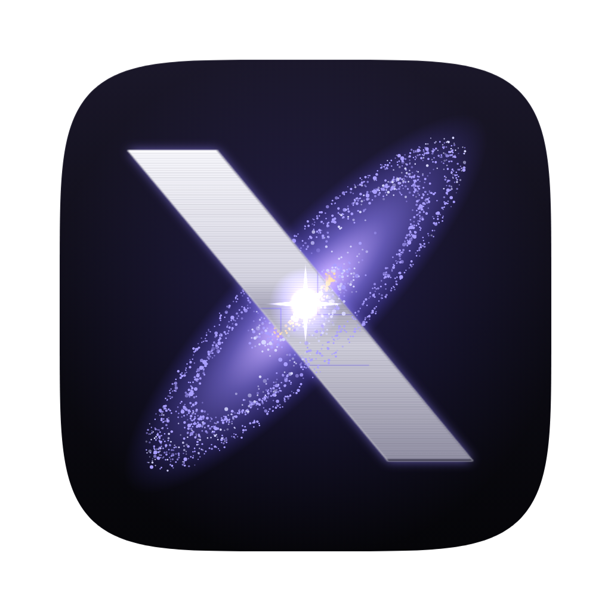

<div align="center">



# GOD OF THE VOID

## The studio that thinks, speaks, draws, films and composes — on your Mac

*An app and an engine, created by [**CHAOS-X**](https://chaosx.space). Everything runs on your machine; the cloud only if you ask for it.*

**A coding agent, a voice you talk to, and engines for images, video, music and
sound — written from scratch in Rust on Apple's MLX. No Python, no server to
rent, no telemetry.**

| You want | Take this | Size |
|---|---|---|
| **The app** | `GOD OF THE VOID.app` from [**Releases**](https://github.com/CHAOSX-SPACE/god-of-the-void/releases) | 478 MB |
| **Only the engine** — no window, just the power | `god-of-the-void-engine-…-macos-arm64.tar.gz` from [**Releases**](https://github.com/CHAOSX-SPACE/god-of-the-void/releases) — [what it does](#the-engine-without-the-app) | 78 MB |
| **To build it yourself** | `cargo run --release -p gotv-empaquetar` — [BUILDING.md](BUILDING.md) | — |


[**User manual**](manual/README.md) · [Models on Hugging Face](https://huggingface.co/god-of-the-void) · [chaosx.space](https://chaosx.space) · [Español](README.es.md)

</div>

---

## See it in two minutes

https://github.com/user-attachments/assets/63ddbbd2-36a3-4ddd-bad0-4c79c6be3e58

*Every zone of the window, narrated. [En español](README.es.md#míralo-en-dos-minutos) · the full [user manual](manual/README.md).*

---

> ### Other studios rent you a brain in someone else's datacenter.
> ### **This one lives on your Mac.**
>
> It reads your code, runs your tests and fixes what breaks. You talk to it and
> it answers out loud. Ask for an image, a video, a song or the sound of rain,
> and it makes it here — with models you chose, under licenses you read.
>
> **Your work, your machine, your models.**

---

> [!IMPORTANT]
> **This is 0.1 — an early, honest release.** It is used every day by the people
> who forge it, and it still has known errors. They are listed
> [below](#known-errors-and-rough-edges), not hidden. Nothing here is sold:
> GOTV is open source, made for the community, and free.

---

## In numbers you can verify

Measured on an Apple M1 Max with 64 GB. Each number comes from the project's
own benchmarks and judges, not from a vendor's page.

| | | how |
|---|---|---|
| **14 crates** | one Rust workspace: engine, core, app, terminal, voice, sound, design, data | `ls crates` |
| **No Python at runtime** | the models run inside the process; MLX is called through FFI | `crates/gotv-mlx` |
| **0.5 s** | first answer of a conversation, down from 9.8 s: the system prompt's cache is read from disk | `prefijo_del_sistema_desde_disco` |
| **−30 % / +13 %** | prefill time / generation speed of a 35B mixture-of-experts model, against the reference server | same model, best of 3, alternated |
| **2.0× real time** | its own voice; first audio in 0.36 s | `gotv say "…"` |
| **25.6 s** | a 1024×1024 image with FLUX.2 klein 4B (512×512 in 8.5–9.8 s) | `gotv image "…"` |
| **6.7 s** | 30 s of music with ACE-Step 1.5 turbo (240 s in 46 s, ~10 GB flat) | `gotv music "…"` |
| **47.8 min** | 2 s of 720p video, 50 steps, with Wan 2.2 TI2V 5B (peak 28.7 GB) | `gotv video "…"` |
| **1,240 tests** | all green, from a fresh clone of this repository — [how](#every-claim-is-tested) | `cargo test --release --workspace` |

**Nothing is claimed that was not measured.** Every engine was checked against
its official reference implementation before it was allowed in: same tokens,
latents within float rounding, and in several cases closer to the exact float64
result than the reference itself.

---

## Two ways in

### The app

- **A coding agent with real tools** — read, write, edit, search, run commands,
  language servers, diagnostics, a map of your code base, semantic search over
  it, and package lookups that read the exact version *your* project uses.
- **Permissions that learn** — plan, ask, accept edits or bypass; allow/deny
  rules; some things are refused even in bypass. Every command runs inside a
  **macOS sandbox** (Seatbelt) that only writes inside your project.
- **Rewind** — undo the last step: the edits *and* what the shell deleted.
- **Reach** — MCP client and server, ACP for editors, projects over SSH,
  databases (SQLite, Postgres, MySQL, DuckDB, CSV/Parquet) with read-only forced
  by the engine, containers, its own browser and control of your Mac's apps —
  each one only when you allow it.
- **Hands-free voice** — talk, interrupt it, keep talking.
- **The Expert studio** — a multitrack studio with the AI at the front: clips,
  automation, mixer, effects, analysis, exporting WAV, FLAC, stems and
  `.dawproject` for Bitwig, Studio One or Cubase.
- **Documents with design** — Word and PDF with themes, charts in the apps it
  builds, REST APIs in Hono, FastAPI or Axum with their tests.
- **Two languages, everywhere** — English and Spanish in every layer, held by a
  judge: a text left in one language fails the test suite.

### The engine — `gotv-mlx`

The heart of the app, and a project of its own: a **multimodal inference engine
written in Rust on Apple's MLX**, with every architecture written by hand. From
this workspace it uses only `gotv-engine` and the MLX bindings: nothing from the
app.

| Sense | Model it runs today | Inside |
|---|---|---|
| **Language** | Qwen 3.5 family, its mixture-of-experts models, Gemma 4 | expert routing, sliding windows, per-layer embeddings, prompt cache on disk |
| **Vision** | Gemma 4 vision | images into the conversation |
| **Hearing** | Whisper large-v3-turbo | voice-activity detection + transcription |
| **Voice** | Qwen3-TTS 1.7B | streaming speech, interruptible |
| **Image** | FLUX.2 klein 4B | guided by a sketch, an isometric scene or up to 4 references |
| **Video** | Wan 2.2 TI2V 5B | text → video and image → video, H.264 through AVFoundation |
| **Music** | ACE-Step 1.5 | instrumentals, songs with lyrics, covers and repaints of your own audio |
| **Sound** | MOSS-SoundEffect 2.0 | rain, doors, explosions |
| **Stems** | HTDemucs (4 / 6 / ft) + [our fine-tunes](https://huggingface.co/god-of-the-void) | vocals, drums, bass, guitar, piano — and drums split into kick, snare, cymbals, toms |
| **Search** | Qwen3-Embedding 0.6B | semantic search over your code |

---

## The engine without the app

You do not need the app to use the engine. Three doors, from easiest to deepest:

### 1 · Download it — one folder, one binary

```sh
curl -LO https://github.com/CHAOSX-SPACE/god-of-the-void/releases/download/v0.1.0/god-of-the-void-engine-0.1.0-macos-arm64.tar.gz
tar -xzf god-of-the-void-engine-0.1.0-macos-arm64.tar.gz
cd god-of-the-void-engine-0.1.0-macos-arm64

./gotv generadores                                   # models, their licenses: accept and download
./gotv image "a lighthouse at dusk" --out lighthouse.png
./gotv music "lo-fi piano, rain" --seconds 30 --out song.wav
./gotv say "Hello from the void" --out hello.wav
./gotv listen --file talk.m4a
./gotv split song.mp3 --six
```

`gotv` and `mlx.metallib` (its Metal kernels) must stay in the same folder. The
licenses of everything inside travel with it.

### 2 · Serve it — any tool that speaks OpenAI or Ollama

```sh
./gotv serve            # http://127.0.0.1:11435
```

```sh
curl http://127.0.0.1:11435/v1/chat/completions \
  -H "Content-Type: application/json" \
  -d '{"model":"gotv","messages":[{"role":"user","content":"Hello"}]}'
```

OpenAI-compatible (`/v1/models`, `/v1/chat/completions`, streaming, tools,
images) **and** Ollama-compatible (`/api/tags`, `/api/chat`, `/api/generate`,
`/api/show`, `/api/ps`). Local only by default; opening it to your network
(`--lan`) requires a key, compared in constant time.

### 3 · Build on it — the Rust crate

```toml
[dependencies]
gotv-mlx = { git = "https://github.com/CHAOSX-SPACE/god-of-the-void", tag = "v0.1.0" }
```

```rust
use std::path::Path;

fn main() -> anyhow::Result<()> {
    let wav = std::fs::read("talk.wav")?;
    let text = gotv_mlx::transcribir_wav(Path::new("whisper-large-v3-turbo"), &wav)?;
    println!("{text}");
    Ok(())
}
```

> [!NOTE]
> The library is **young**: its API is shaped by the app, many names are in
> Spanish, and it will change before 1.0. A stable English API and a release on
> crates.io are on the roadmap. Use a tag, and expect to adapt.

---

## Known errors and rough edges

Said here, so nobody finds them by surprise:

- **Long jobs.** The fix for closing early on long tasks (context compaction)
  is in, with its tests green, but it has **not yet been measured end to end**
  with a local model.
- **Not there yet:** several agents at once, forking a chat, automations,
  mobile devices from the app, and parts of the window (changes view, mentions).
- **Half-translated corners:** in English mode a few CLI words are still Spanish
  (`gotv generadores`, `--perfil programar|diseno`, `--fuerza-cover`). The
  English aliases cover the main commands (`image`, `music`, `say`, `listen`,
  `split`, `talk`).
- **One flaky test:** the `gotv-mlx` test binary has crashed once in ~26 runs
  (SIGTRAP) under heavy machine load; re-running passes. Cause not found yet.
- **Video is slow:** 2 seconds of 720p take ~48 minutes on an M1 Max.
- **Not notarized by Apple** — on purpose: GOTV is free and does not pay to be
  opened. The first launch needs one click ([how](#install-the-app)).
- **Apple Silicon only:** MLX runs on the Apple GPU. No Intel, Linux or Windows.

Found another one? [Open an issue](https://github.com/CHAOSX-SPACE/god-of-the-void/issues)
with your Mac, your macOS and what happened.

---

## Every model keeps its own license

No model ships inside GOTV. The first time something needs one, GOTV shows
**its** license, and downloads it from **its** publisher only after you accept.
Licenses are checked against each publisher's own page — the model card, and
the weights' terms when they live elsewhere.

| | Model | Publisher | License |
|---|---|---|---|
| Hearing | Whisper large-v3-turbo | OpenAI | MIT |
| Voice | Qwen3-TTS 1.7B | Qwen | Apache-2.0 |
| Images | FLUX.2 klein 4B · klein base 4B | Black Forest Labs | Apache-2.0 |
| Video | Wan 2.2 TI2V 5B | Wan-AI | Apache-2.0 |
| Music | ACE-Step 1.5 · base · SFT · LM 4B | ACE-Step | MIT |
| Sound | MOSS-SoundEffect 2.0 | OpenMOSS | Apache-2.0 |
| Search | Qwen3-Embedding 0.6B | Qwen | Apache-2.0 |
| Stems | HTDemucs · 6 stems · ft | Alexandre Défossez | ⚠ **research only** — its author states the weights' license is not clear |
| Stems | [HTDemucs fine-tunes](https://huggingface.co/god-of-the-void) | GOD OF THE VOID | ⚠ **research only** — inherited from HTDemucs; data credited (CC BY) |

Language models are yours to choose: any MLX model of a supported family.

---

## Install the app

**Download** `GOD OF THE VOID.app` from
[Releases](https://github.com/CHAOSX-SPACE/god-of-the-void/releases), unzip it and
move it to **Applications**.

> [!TIP]
> **The first time, macOS will refuse to open it** — GOTV is not notarized.
> Go to **System Settings → Privacy & Security**, find *"GOD OF THE VOID was
> blocked"* and press **Open Anyway**. Only once. Or build it yourself: an app
> you build is never blocked.

**From the terminal**, the CLI lives inside the app:

```sh
echo "alias gotv='\"/Applications/GOD OF THE VOID.app/Contents/MacOS/gotv\"'" >> ~/.zshrc
gotv "fix the failing test"        # in a new terminal, inside your project
```

**Requirements:** a Mac with Apple Silicon (M1 or newer) and macOS 14 or newer.
Memory decides which models fit, and GOTV tells you which ones do.

---

## What leaves your Mac

**No telemetry.** GOTV connects only when you use something that needs it:
downloading a model from Hugging Face, a web search with your own keys, a
package lookup, a cloud model you turned on. Your keys go to the macOS
Keychain, never into a file or the chat.

---

## Every claim is tested

```sh
cargo test --release --workspace
```

**1,240 pass, 0 fail** — measured on a fresh copy of this repository, not on
the forge. 152 more need the real models downloaded and are marked ignored
(`cargo test --release -- --ignored`). And the published build has to pass its
own judge: no file of
the app or the engine may carry the builder's home folder, a real-looking key or
their Hugging Face token, or the packer refuses to finish. Model licenses are
re-read from each publisher with `gotv generadores verificar`.

| Platform | |
|---|---|
| **macOS, Apple Silicon** | ✅ the only platform: built, tested and used every day |
| **macOS, Intel** | ❌ no MLX |
| **Linux, Windows** | ❌ not today |

---

## Built on

[MLX](https://github.com/ml-explore/mlx) (Apple) through
[mlx-rs](https://github.com/oxiglade/mlx-rs) · [Tauri](https://tauri.app) ·
[agent-desktop](https://github.com/vercel-labs/agent-desktop) and
[agent-browser](https://github.com/vercel-labs/agent-browser) (Vercel Labs) ·
sandbox policies from [Codex](https://github.com/openai/codex) (OpenAI) ·
[DuckDB](https://duckdb.org) · [ratatui](https://ratatui.rs) ·
[Silero VAD](https://github.com/snakers4/silero-vad). Their licenses travel in
[NOTICE](NOTICE) and inside the app.

[Contributing](CONTRIBUTING.md) · [Security](SECURITY.md) · [Building](BUILDING.md)

---

<div align="center">

### GOD OF THE VOID is created by [CHAOS-X](https://chaosx.space)

**An open science academy where you learn, measure and share with real
instruments — free, in English and Spanish.**
The course, the lab to practice, the book to go deeper, real data from the
planet and the community to discuss it, in one place. Truth over ornament, and
Rust from end to end — the same rules this studio was built by.

[**chaosx.space**](https://chaosx.space) · [Academy](https://academy.chaosx.space/) · [Virtual lab](https://academy.chaosx.space/lab/) · [Library](https://chaosx.space/library/) · [100-year Atlas](https://nodes.chaosx.space/atlas) · [NODES-X](https://chaosx.space/nodes/) · [Live data](https://chaosx.space/data/) · [Community](https://forum.chaosx.space/) · [The Cosmos Dispatch](https://chaosx.space/news/)

*Looking for the Claude Code skill with persistent memory?*
→ [**god-of-the-void-skill**](https://github.com/CHAOSX-SPACE/god-of-the-void-skill)

---

<i>Everything that enters the Void does not return — except what you made in it.</i>

**Apache-2.0** — take it, fork it, make it better. Keep the [NOTICE](NOTICE),
give your fork its own name, and tell people where it came from.

<sub>Built by CHAOS-X with the help of AI models: Claude Opus 5.5 and Claude Fable 5.2, by Anthropic.</sub>

</div>
